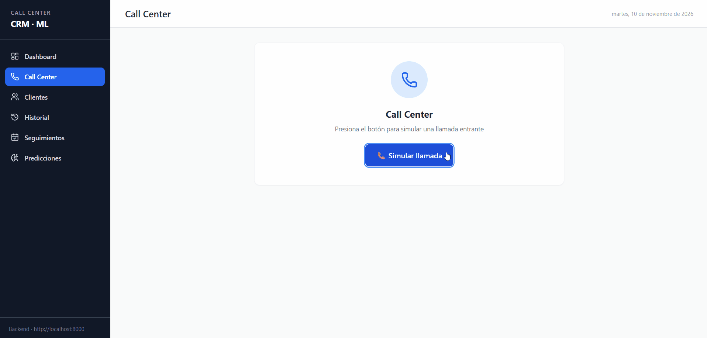
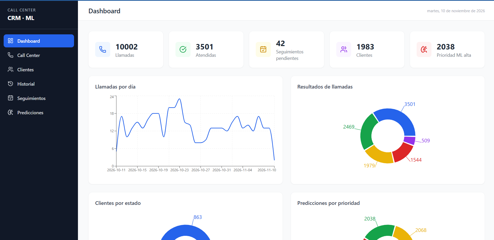
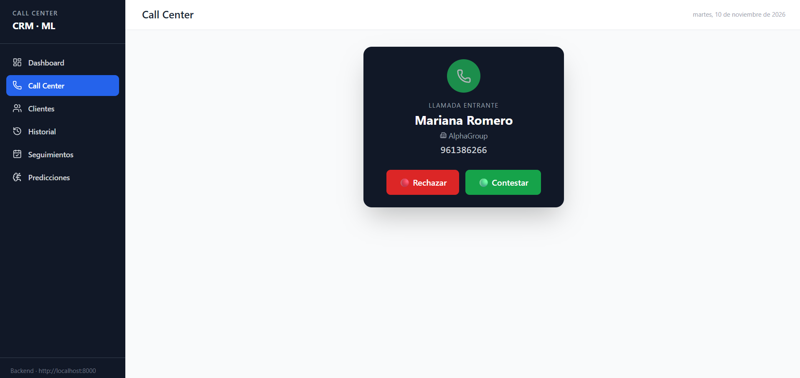
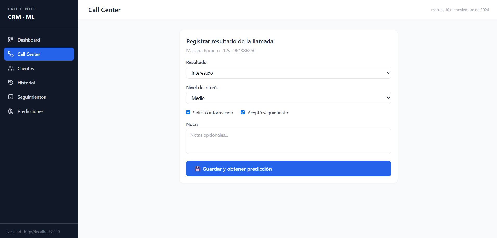
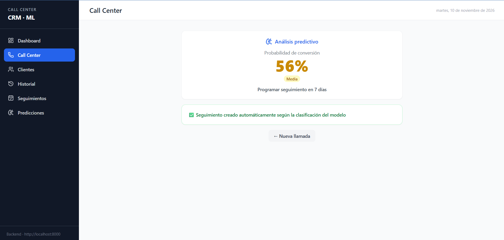
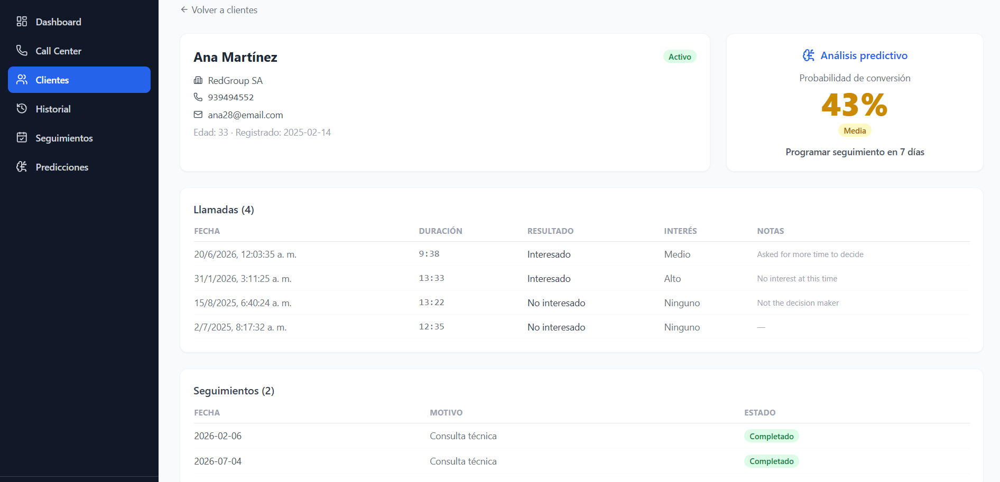
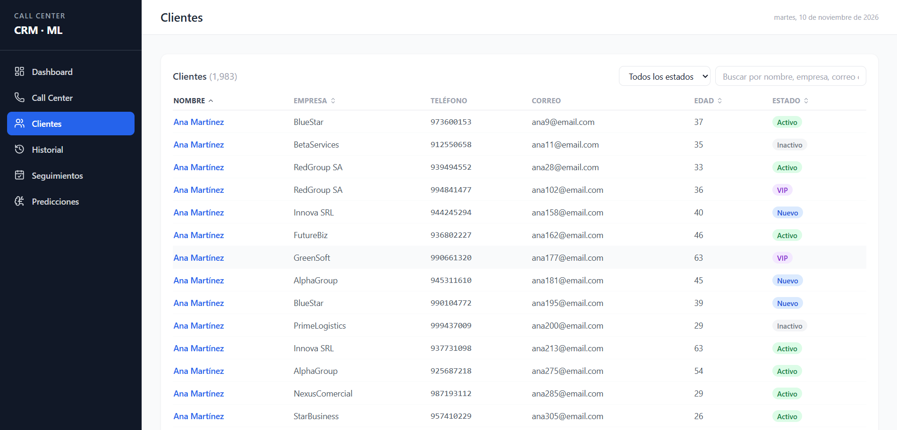
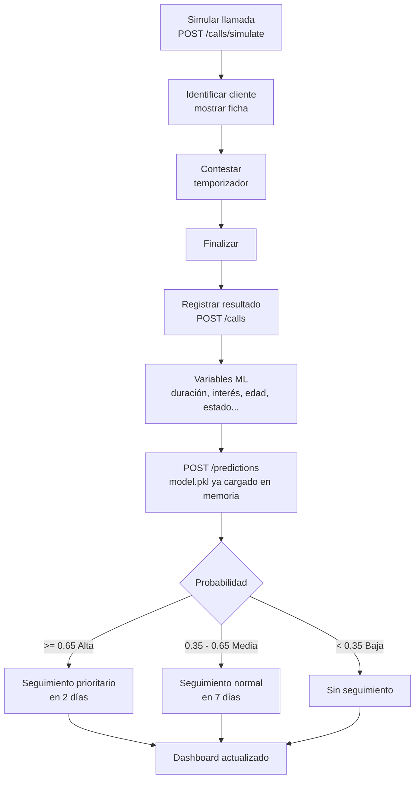

# Call Center CRM + Machine Learning (demo)

Local prototype of a call-center system: simulate incoming calls, manage customers,
register interactions, predict the conversion probability with a scikit-learn model and
create follow-ups automatically. Free and fully local (PostgreSQL + FastAPI + React).

> Convention: code, database and API are in **English**; only the text shown to the
> end user in the UI is in **Spanish** (see `frontend/src/i18n/labels.js`).



## Screenshots

| Dashboard | Incoming call |
|---|---|
|  |  |

| Call result form | ML prediction + automatic follow-up |
|---|---|
|  |  |

| Customer detail | Customers (server-side pagination) |
|---|---|
|  |  |

## Architecture

```
React (Vite + Tailwind)  ->  FastAPI  ->  PostgreSQL
                                |
                            model.pkl (scikit-learn)
```

## Call flow



The model is trained offline (`ml/train_model.py`) and loaded once when the API starts;
predicting a call never reads the CSV or retrains.

## Project structure

```
data/        dataset_calls.csv / .xlsx          (generated, git-ignored)
database/    schema.sql, load_dataset.py        (structure + bulk load with COPY)
ml/          generate_dataset.py, explore_data.py, train_model.py,
             evaluate_model.py, model.pkl, reports/
backend/     FastAPI app (models, schemas, routes, services)
frontend/    React app (pages, components, api, i18n)
tests/       API integration tests (pytest)
docs/        Postman collection, screenshots and demo GIF
```

## Setup

Requirements: Python 3.13, Node 20+, PostgreSQL 14+.

```bash
# 1. Python dependencies
pip install -r requirements.txt

# 2. Database credentials: copy backend/.env.example to backend/.env and fill in your values
#    (create the empty database call_center_db first)
cp backend/.env.example backend/.env

# 3. Dataset + model (the number of records is NUM_RECORDS in generate_dataset.py)
cd ml
python generate_dataset.py
python explore_data.py        # optional: exploratory analysis
python train_model.py         # trains 3 models, saves the best as model.pkl
python evaluate_model.py      # metrics on the test split -> reports/evaluation.json
cd ..

# 4. Create the tables and load the dataset (run from the project root)
python -m database.load_dataset --schema

# 5. Backend  -> http://localhost:8000/docs
uvicorn backend.main:app --reload --port 8000

# 6. Frontend -> http://localhost:5173
cd frontend && npm install && npm run dev
```

`load_dataset.py` empties the four tables before loading. `schema.sql` alone creates the
structure plus 10 demo customers; use it instead of the loader if you want a tiny database.

## API (main endpoints)

| Resource | Endpoints |
|---|---|
| Customers | `GET /customers?q=&status=`, `GET/PUT /customers/{id}`, `POST /customers` |
| Calls | `GET /calls?customer_id=&outcome=`, `GET /calls/{id}`, `POST /calls`, `POST /calls/simulate` |
| Follow-ups | `GET /followups?status=&customer_id=`, `POST /followups`, `PUT /followups/{id}` |
| ML | `POST /predictions` (predicts, stores it and creates the follow-up), `GET /predictions?customer_id=` |
| Dashboard | `/dashboard/metrics`, `calls-per-day`, `call-outcomes`, `customers-by-status`, `predictions-by-class`, `probability-distribution`, `priority-customers`, `pending-followups` |

Classification rules: probability >= 0.65 -> **High** (follow-up in 2 days), 0.35-0.65 -> **Medium**
(follow-up in 7 days), < 0.35 -> **Low** (no follow-up).

## Postman

Import `docs/call_center.postman_collection.json` (variable `baseUrl` = `http://localhost:8000`).
The requests are ordered like the demo; it is regenerated from the API with `python docs/export_postman.py`.

## Pagination (server-side)

Every list endpoint (`/customers`, `/calls`, `/followups`, `/predictions`) paginates in the database with
`LIMIT/OFFSET`, DataTables style: only one page travels to the browser.

| Query parameter | Meaning |
|---|---|
| `page`, `page_size` | 1-based page and rows per page (default 25, max 100) |
| `q` | free-text search (customer name, company, notes... depends on the endpoint) |
| `sort_by`, `sort_dir` | whitelisted column and `asc`/`desc` (unknown columns fall back to the default) |
| filters | `status`, `outcome`, `classification`, `customer_id` |

Response: `{ "items": [...], "total": N, "page": 1, "page_size": 25, "pages": K }`, where `total` counts
the rows matching the filters. The frontend uses one reusable component, `components/ui/DataTable.jsx`.

## Tests

```bash
python -m pytest tests -v
```

They run against the real database; each test creates its own customer and deletes it afterwards.

## Demo script

1. **Dashboard**: show the KPIs, the charts and the priority customers.
2. **Call Center -> Simular llamada**: an incoming call appears with the customer card.
3. **Contestar**: the timer starts.
4. **Finalizar**: fill in the result (e.g. Interesado, interés Alto, solicitó información, aceptó seguimiento).
5. **Guardar y obtener predicción**: probability, priority and recommendation are shown.
6. **Automation**: the follow-up created automatically is shown (also in *Seguimientos* and in the customer detail).
7. **Dashboard** again: the call count and the pending follow-ups increased.

Tip: to show the Low branch, register a call with result *No interesado*, interest *Ninguno* and no checkboxes:
no follow-up is created.

## Machine learning notes

- Target: `purchased` (0/1). Features: call duration, requested info, accepted follow-up,
  has follow-up, age, call outcome, interest level and customer status.
- Three models are compared (Logistic Regression, Decision Tree, Random Forest) with a held-out 20 % split
  and 5-fold cross-validation. Selection rule: keep the models tied on cross-validated F1 (within 1 std) and
  pick the one with the best-calibrated probabilities (lowest Brier score), because High/Medium/Low come
  from the probability. Currently this selects **Random Forest** (test F1 0.660, ROC-AUC 0.839, Brier 0.150).
  All metrics are computed by the code; none are hand-written.
- The dataset is **synthetic**: the target is generated from a rule plus noise, so the model recovers
  that rule. Do not present the metrics as real-world performance.

## Author

**Luis Daniel Alva Lujan** · [LinkedIn](https://www.linkedin.com/in/luis-daniel-alva-lujan/)

Released under the [MIT License](LICENSE).
